# คู่มือและเอกสารสรุประบบ IT RUNWAY (System Documentation)

**IT RUNWAY** คือ แพลตฟอร์มศูนย์รวมงานวิ่ง ระบบลงทะเบียน ออกเบอร์วิ่งดิจิทัล (Digital BIB) ระบบจับเวลา RFID การเช็คอินเข้างานด้วย QR Code และระบบจัดการแข่งขันครบวงจร สำหรับงานวิ่งในจังหวัดนครปฐมและพื้นที่ใกล้เคียง

---

## สารบัญระบบ (Table of Contents)

1. [สถาปัตยกรรมฐานข้อมูล 31 ตาราง (Complete Database Schema - 31 Tables)](#1-สถาปัตยกรรมฐานข้อมูล-31-ตาราง)
   - [1.1 กลุ่มตารางผู้ใช้และการยืนยันตัวตน (Core Users & Auth: 3 ตาราง)](#11-กลุ่มตารางผู้ใช้และการยืนยันตัวตน)
   - [1.2 กลุ่มตารางงานวิ่งและข้อมูลการแข่งขัน (Events & Information: 6 ตาราง)](#12-กลุ่มตารางงานวิ่งและข้อมูลการแข่งขัน)
   - [1.3 กลุ่มตารางการลงทะเบียนและการจัดการสิทธิ์ (Registrations & Self-Service: 4 ตาราง)](#13-กลุ่มตารางการลงทะเบียนและการจัดการสิทธิ์)
   - [1.4 กลุ่มตาราง BIB ชิป RFID และการเช็คอิน (BIB, RFID & Check-in: 3 ตาราง)](#14-กลุ่มตาราง-bib-ชิป-rfid-และการเช็คอิน)
   - [1.5 กลุ่มตารางการชำระเงินและธุรกรรม (Payments & Financials: 3 ตาราง)](#15-กลุ่มตารางการชำระเงินและธุรกรรม)
   - [1.6 กลุ่มตารางผลการแข่งขันและสถิติเวลา (Race Results & Timing: 3 ตาราง)](#16-กลุ่มตารางผลการแข่งขันและสถิติเวลา)
   - [1.7 กลุ่มตารางการจัดส่งอุปกรณ์ (Shipping & Logistics: 2 ตาราง)](#17-กลุ่มตารางการจัดส่งอุปกรณ์)
   - [1.8 กลุ่มตารางเกียรติบัตรและคลังภาพถ่าย (Media & Certificates: 3 ตาราง)](#18-กลุ่มตารางเกียรติบัตรและคลังภาพถ่าย)
   - [1.9 กลุ่มตารางผู้จัดงานและทีมงาน (Organizers & Permissions: 2 ตาราง)](#19-กลุ่มตารางผู้จัดงานและทีมงาน)
   - [1.10 กลุ่มตารางการแจ้งเตือนและบันทึกประวัติ (Notifications & Audit Logs: 2 ตาราง)](#110-กลุ่มตารางการแจ้งเตือนและบันทึกประวัติ)
2. [ระดับผู้ใช้งานและสิทธิ์การเข้าถึง (User Roles & Permissions)](#2-ระดับผู้ใช้งานและสิทธิ์การเข้าถึง)
3. [ระบบหลักทั้งหมดของแพลตฟอร์ม (Platform Modules & Features)](#3-ระบบหลักทั้งหมดของแพลตฟอร์ม)
4. [รายการ API Endpoints ทั้งหมด (REST API Reference)](#4-รายการ-api-endpoints-ทั้งหมด)
5. [บัญชีผู้ใช้งานตัวอย่างสำหรับทดสอบ (Demo Credentials & Testing Guide)](#5-บัญชีผู้ใช้งานตัวอย่างสำหรับทดสอบ)
6. [ข้อมูลการติดตั้งและเผยแพร่ (Production Deployment)](#6-ข้อมูลการติดตั้งและเผยแพร่)

---

## 1. สถาปัตยกรรมฐานข้อมูล 31 ตาราง

ฐานข้อมูล PostgreSQL ของระบบ IT RUNWAY ได้รับการออกแบบโครงสร้างเชิงสัมพันธ์ (Relational Schema) ครอบคลุมการทำงานทุกมิติของงานวิ่ง รวมทั้งสิ้น **31 ตาราง (31 Tables)**:

```mermaid
erDiagram
    %% Core Auth & Users
    users ||--o{ accounts : "has credentials"
    users ||--o{ sessions : "has sessions"
    users ||--o{ registrations : "registers"
    users ||--o{ organizer_requests : "submits"
    users ||--o{ organizer_members : "staffs in"
    users ||--o{ notifications : "receives"
    users ||--o{ audit_logs : "triggers"

    %% Events & Metadata
    events ||--o{ event_categories : "has distances"
    events ||--o{ event_checkpoints : "has timing mats"
    events ||--o{ event_schedules : "has timeline"
    events ||--o{ event_rules : "has regulations"
    events ||--o{ event_awards : "has trophies"
    events ||--o{ registrations : "enrolls"
    events ||--o{ bib_numbers : "allocates"
    events ||--o{ race_results : "measures"
    events ||--o{ race_rankings : "ranks"
    events ||--o{ photos : "stores media"
    events ||--o{ organizer_members : "managed by"

    %% Registrations & Self-Service
    registrations ||--o{ registration_items : "contains goods"
    registrations ||--o{ registration_transfers : "transfer history"
    registrations ||--o{ registration_cancellations : "cancel history"
    registrations ||--o{ checkins : "gate scans"
    registrations ||--o{ payments : "payment invoice"
    registrations ||--o{ race_results : "achieves"
    registrations ||--o{ shipping : "delivery order"
    registrations ||--o{ shipping_tracking : "courier status"
    registrations ||--o{ certificates : "earns certificate"

    %% Results & Photos
    race_results ||--o{ race_splits : "checkpoint splits"
    photos ||--o{ photo_checkpoints : "bib recognition"
    payments ||--o{ payment_transactions : "gateway txn"
    payments ||--o{ refunds : "refund txn"
```

---

### 1.1 กลุ่มตารางผู้ใช้และการยืนยันตัวตน (Core Users & Auth: 3 ตาราง)

#### 1. `users` (`user`)
ตารางเก็บข้อมูลบัญชีผู้ใช้งานและข้อมูลสุขภาพ/ประวัตินักวิ่ง
- **`id`** (TEXT, PK): รหัสผู้ใช้งาน
- **`name`** (TEXT): ชื่อ-นามสกุล
- **`email`** (TEXT, Unique): อีเมลผู้ใช้
- **`email_verified`** (BOOLEAN): สถานะยืนยันอีเมล
- **`image`** (TEXT): รูปโปรไฟล์
- **`role`** (TEXT): สิทธิ์ (`user`, `admin`)
- **`phone_number`** (TEXT, Unique): เบอร์โทรศัพท์ติดต่อ
- **`gender`** (TEXT): เพศ (`male`, `female`)
- **`birthdate`** (TEXT): วัน/เดือน/ปีเกิด
- **`blood_type`** (TEXT): หมู่โลหิต (`A`, `B`, `O`, `AB`, `Rh-`)
- **`emergency_name`** (TEXT): ชื่อผู้ติดต่อกรณีฉุกเฉิน
- **`emergency_phone`** (TEXT): เบอร์ติดต่อกรณีฉุกเฉิน
- **`medical_conditions`** (TEXT): โรคประจำตัว / ประวัติการแพ้ยา
- **`tshirt_size`** (TEXT): ไซส์เสื้อประจำตัว (`XS`–`3XL`)
- **`preferred_distance`** (TEXT): ระยะทางที่ถนัด (`5K`, `10K`, `21K`, `42K`)
- **`running_club`** (TEXT): สังกัด / ชมรมวิ่ง
- **`target_pace`** (TEXT): เพซเป้าหมาย (เช่น `05:30`)
- **`chip_code`** (TEXT): รหัสชิป RFID ประจำตัว

#### 2. `accounts` (`account`)
ตารางเชื่อมโยงข้อมูลการยืนยันตัวตน รหัสผ่าน และ OAuth Credentials
- **`id`** (TEXT, PK): รหัส Account Record
- **`account_id`** (TEXT): Provider Account ID
- **`provider_id`** (TEXT): ผู้ให้บริการล็อกอิน (`credential`, `google`, `line`)
- **`user_id`** (TEXT, FK -> `user.id`): รหัสผู้ใช้
- **`password`** (TEXT): แฮชรหัสผ่านที่เข้ารหัสความปลอดภัยสูง
- **`access_token`**, **`refresh_token`**, **`id_token`** (TEXT): โทเค็นการเชื่อมต่อ

#### 3. `sessions` (`session`)
ตารางจัดการเซสชันการเข้าสู่ระบบแบบ Type-Safe ป้องกัน Session Hijacking
- **`id`** (TEXT, PK): รหัสเซสชัน
- **`token`** (TEXT, Unique): เซสชันโทเค็น
- **`user_id`** (TEXT, FK -> `user.id`): รหัสผู้ใช้
- **`expires_at`** (TIMESTAMP): เวลาหมดอายุเซสชัน
- **`ip_address`** (TEXT): ไอพีที่เข้าใช้งาน
- **`user_agent`** (TEXT): ข้อมูล Browser/Device
- **`impersonated_by`** (TEXT): รหัสแอดมิน (กรณีสวมสิทธิ์ช่วยตรวจสอบปัญหา)

---

### 1.2 กลุ่มตารางงานวิ่งและข้อมูลการแข่งขัน (Events & Information: 6 ตาราง)

#### 4. `events`
ตารางหลักสำหรับเก็บข้อมูลงวดการแข่งขันวิ่งในจังหวัดนครปฐม
- **`id`** (UUID, PK): รหัสงานวิ่ง
- **`title`** (TEXT): ชื่องานวิ่ง (เช่น Nakhon Pathom Half Marathon 2026)
- **`location`** (TEXT): สถานที่จัดงาน (เช่น พระปฐมเจดีย์, ม.เกษตรฯ กำแพงแสน)
- **`date`** (TIMESTAMPTZ): วันและเวลาแข่งขัน
- **`distance`** (TEXT): ข้อความสรุประยะทาง (เช่น "5 / 10 / 21 KM")
- **`price`** (INTEGER): ราคาเริ่มต้น (บาท)
- **`status`** (TEXT): สถานะรับสมัคร (`open`, `closed`)
- **`image`** (TEXT): ภาพแบนเนอร์ความคมชัดสูง
- **`organizer_id`** (TEXT): รหัสผู้จัดงาน
- **`organizer_name`** (TEXT): ชื่อองค์กร / สโมสรผู้จัด
- **`organizer_contact`** (TEXT): ข้อมูลติดต่อผู้จัดงาน
- **`approval_status`** (TEXT): สถานะการอนุมัติ (`pending`, `approved`, `rejected`)

#### 5. `event_categories`
ตารางจำแนกหมวดหมู่ระยะทางและโควตาผู้เข้าร่วม
- **`id`** (UUID, PK): รหัส Category
- **`event_id`** (UUID, FK -> `events.id`): รหัสงานวิ่ง
- **`name`** (TEXT): ชื่อระยะ (เช่น "Half Marathon 21.1 KM")
- **`distance_km`** (NUMERIC): ระยะทางคำนวณเป็นกิโลเมตร
- **`price`** (INTEGER): ค่าสมัครของระยะนั้นๆ
- **`slots`** (INTEGER): จำนวนโควตารับสมัครทั้งหมด
- **`registered_count`** (INTEGER): ยอดผู้สมัครปัจจุบัน
- **`cut_off_time_minutes`** (INTEGER): เวลาตัดตัว (Cut-off Time) เช่น 210 นาที
- **`start_time`** (TEXT): เวลาปล่อยตัว (เช่น "05:00 น.")

#### 6. `event_checkpoints`
ตารางบันทึกจุดเช็คพอยต์ timing mats และจุดบริการทางการแพทย์/ให้น้ำ
- **`id`** (UUID, PK): รหัส Checkpoint
- **`event_id`** (UUID, FK -> `events.id`): รหัสงานวิ่ง
- **`name`** (TEXT): ชื่อจุดเช็คพอยต์ (เช่น "กม. 5 ถนนราชดำเนิน", "เส้นชัย พระปฐมเจดีย์")
- **`distance_from_start_km`** (NUMERIC): ระยะห่างจากจุดปล่อยตัว
- **`has_water_station`** (BOOLEAN): จุดให้น้ำ/เกลือแร่
- **`has_medical_station`** (BOOLEAN): จุดพยาบาลและรถฉุกเฉิน
- **`has_timing_mat`** (BOOLEAN): พรมตรวจจับสัญญาณชิป RFID

#### 7. `event_schedules`
ตารางกำหนดการและไทม์ไลน์วันแข่งขัน
- **`id`** (UUID, PK): รหัสกำหนดการ
- **`event_id`** (UUID, FK -> `events.id`): รหัสงานวิ่ง
- **`time`** (TEXT): เวลา (เช่น "03:30 น.")
- **`title`** (TEXT): กิจกรรม (เช่น "เปิดจุดรับฝากของ และเปิดเต็นท์พยาบาล")
- **`description`** (TEXT): รายละเอียดเพิ่มเติม
- **`sort_order`** (INTEGER): ลำดับการจัดเรียง

#### 8. `event_rules`
ตารางกติกาการแข่งขัน ข้อปฏิบัติ และมาตรการความปลอดภัย
- **`id`** (UUID, PK): รหัสกฎระเบียบ
- **`event_id`** (UUID, FK -> `events.id`): รหัสงานวิ่ง
- **`category`** (TEXT): หมวดหมู่กติกา (`general`, `timing`, `safety`, `awards`)
- **`title`** (TEXT): หัวข้อกติกา
- **`description`** (TEXT): คำอธิบายข้อกำหนด

#### 9. `event_awards`
ตารางรางวัล โล่เกียรติยศ และเงินรางวัลประจำรุ่น
- **`id`** (UUID, PK): รหัสรางวัล
- **`event_id`** (UUID, FK -> `events.id`): รหัสงานวิ่ง
- **`distance`** (TEXT): ระยะทางที่มอบรางวัล
- **`category`** (TEXT): หมวดรางวัล (เช่น "Overall ชาย อันดับ 1", "รุ่นอายุ 30-39 ปี")
- **`trophy_description`** (TEXT): รายละเอียดถ้วย/เหรียญรางวัล
- **`prize_money`** (INTEGER): เงินรางวัล (บาท)

---

### 1.3 กลุ่มตารางการลงทะเบียนและการจัดการสิทธิ์ (Registrations & Self-Service: 4 ตาราง)

#### 10. `registrations`
ตารางหลักของบัตรลงทะเบียนนักวิ่ง (Digital BIB Record)
- **`id`** (UUID, PK): รหัสการลงทะเบียน
- **`user_id`** (TEXT, FK -> `user.id`): ผู้สมัคร
- **`event_id`** (UUID, FK -> `events.id`): งานวิ่งที่สมัคร
- **`bib_number`** (TEXT): หมายเลข BIB (เช่น "1088")
- **`corral`** (TEXT): กลุ่มปล่อยตัว (เช่น "CORRAL A")
- **`distance`** (TEXT): ระยะทางที่ลงแข่ง (เช่น "21 KM")
- **`tshirt_size`** (TEXT): ไซส์เสื้อวิ่ง
- **`status`** (TEXT): สถานะบัตร (`upcoming`, `completed`, `cancelled`)
- **`chip_code`** (TEXT): รหัสชิปจับเวลา RFID
- **`shipping_status`** (TEXT): วิธีรับอุปกรณ์ (`pickup` รับหน้างาน, `delivered` ส่งไปรษณีย์)
- **`tracking_number`** (TEXT): หมายเลขพัสดุ
- **`checked_in`** (TEXT): สถานะเช็คอินหน้างาน (`yes`, `no`)
- **`checked_in_at`** (TIMESTAMPTZ): เวลาที่สแกนเช็คอิน
- **`official_time`**, **`pace`**, **`rank`** (TEXT): สถิติการแข่งขันเมื่อวิ่งจบ

#### 11. `registration_items`
ตารางแจกแจงรายการสินค้าและบริการในคำสั่งซื้อ
- **`id`** (UUID, PK): รหัสรายการสินค้า
- **`registration_id`** (UUID, FK -> `registrations.id`): ใบลงทะเบียน
- **`item_type`** (TEXT): ประเภท (`race_slot`, `tshirt`, `medal_engraving`, `photo_package`)
- **`item_name`** (TEXT): ชื่อรายการ
- **`unit_price`** (INTEGER): ราคาต่อหน่วย
- **`quantity`** (INTEGER): จำนวน

#### 12. `registration_transfers`
ตารางบันทึกประวัติการโอนสิทธิ์เบอร์วิ่งให้ผู้อื่น
- **`id`** (UUID, PK): รหัสการโอนสิทธิ์
- **`registration_id`** (UUID, FK -> `registrations.id`): ใบลงทะเบียนที่ถูกโอน
- **`from_user_id`** (TEXT, FK -> `user.id`): ผู้โอนสิทธิ์
- **`to_user_id`** (TEXT, FK -> `user.id`): บัญชีผู้รับโอน (ถ้ามี)
- **`to_runner_name`** (TEXT): ชื่อ-นามสกุลผู้รับสิทธิ์คนใหม่
- **`to_runner_phone`** (TEXT): เบอร์โทรศัพท์ผู้รับสิทธิ์คนใหม่
- **`old_chip_code`** (TEXT): รหัสชิป RFID เดิม
- **`new_chip_code`** (TEXT): รหัสชิป RFID ใหม่ที่ออกให้
- **`transferred_at`** (TIMESTAMPTZ): วันเวลาที่โอนสิทธิ์สำเร็จ

#### 13. `registration_cancellations`
ตารางบันทึกการขอยกเลิกบัตรวิ่งและประวัติการคืนเงิน (Refund Log)
- **`id`** (UUID, PK): รหัสการยกเลิก
- **`registration_id`** (UUID, FK -> `registrations.id`): ใบลงทะเบียนที่ขอยกเลิก
- **`user_id`** (TEXT, FK -> `user.id`): ผู้ขอยกเลิก
- **`reason`** (TEXT): เหตุผลการขอยกเลิก
- **`refund_method`** (TEXT): ช่องทางรับเงินคืน (`promptpay`, `bank_account`)
- **`refund_account`** (TEXT): หมายเลขบัญชี/เบอร์พร้อมเพย์รับเงินคืน
- **`refund_amount`** (INTEGER): ยอดเงินที่ได้รับคืน
- **`status`** (TEXT): สถานะดำเนินการ (`completed`, `rejected`)

---

### 1.4 กลุ่มตาราง BIB ชิป RFID และการเช็คอิน (BIB, RFID & Check-in: 3 ตาราง)

#### 14. `bib_numbers`
ตารางจัดการคลังหมายเลข BIB ประจำระยะทางและกลุ่มบล็อกปล่อยตัว
- **`id`** (UUID, PK): รหัส BIB Pool
- **`event_id`** (UUID, FK -> `events.id`): งานวิ่ง
- **`bib_code`** (TEXT): ตัวเลข BIB (เช่น "1088")
- **`distance`** (TEXT): ระยะทาง
- **`corral`** (TEXT): บล็อกปล่อยตัว
- **`is_assigned`** (BOOLEAN): ถูกนำไปใช้แล้วหรือไม่

#### 15. `rfid_chips`
ตารางจับคู่อุปกรณ์ชิปจับเวลาและคลื่นความถี่ RFID UHF
- **`id`** (UUID, PK): รหัสชิปในระบบ
- **`chip_code`** (TEXT, Unique): รหัสยิงชิป (เช่น "NP-TIMING-1088")
- **`frequency_band`** (TEXT): ย่านความถี่ (`UHF 920-925MHz`)
- **`status`** (TEXT): สถานะชิป (`active`, `damaged`, `lost`)
- **`last_read_time`** (TIMESTAMPTZ): เวลาตรวจจับสัญญาณล่าสุด

#### 16. `checkins`
ตารางประวัติการสแกนเข้างานหน้าประตูทางเข้า (Gate Access Logs)
- **`id`** (UUID, PK): รหัสบันทึกการเข้างาน
- **`registration_id`** (UUID, FK -> `registrations.id`): บัตร BIB
- **`event_id`** (UUID, FK -> `events.id`): งานวิ่ง
- **`bib_number`** (TEXT): หมายเลข BIB
- **`gate_location`** (TEXT): จุดประตูทางเข้า (เช่น "Gate 1 - Expo Hall")
- **`method`** (TEXT): วิธีตรวจ (`qr_camera`, `rfid_gate`, `manual`)
- **`checked_in_by_user_id`** (TEXT, FK -> `user.id`): เจ้าหน้าที่ผู้ตรวจ
- **`checked_in_at`** (TIMESTAMPTZ): เวลาสแกนสำเร็จ

---

### 1.5 กลุ่มตารางการชำระเงินและธุรกรรม (Payments & Financials: 3 ตาราง)

#### 17. `payments`
ตารางบันทึกยอดชำระเงินและใบเสร็จ
- **`id`** (UUID, PK): รหัสการชำระเงิน
- **`registration_id`** (UUID, FK -> `registrations.id`): ใบลงทะเบียน
- **`user_id`** (TEXT, FK -> `user.id`): ผู้จ่ายเงิน
- **`amount`** (INTEGER): ยอดเงินชำระ (บาท)
- **`payment_method`** (TEXT): ช่องทาง (`promptpay`, `credit_card`, `mobile_banking`, `wallet`)
- **`status`** (TEXT): สถานะชำระเงิน (`completed`, `refunded`, `failed`)

#### 18. `payment_transactions`
ตารางบันทึก Log การติดต่อสื่อสารกับ Payment Gateway
- **`id`** (UUID, PK): รหัส Transaction
- **`payment_id`** (UUID, FK -> `payments.id`): รหัสใบเสร็จ
- **`transaction_ref`** (TEXT, Unique): รหัสอ้างอิงธุรกรรมธนาคาร
- **`gateway_provider`** (TEXT): ผู้ให้บริการเกตเวย์
- **`gateway_status`** (TEXT): ผลตอบรับจากระบบการเงิน (`SUCCESS`)

#### 19. `refunds`
ตารางบันทึกการโอนเงินคืนแก่นักวิ่ง
- **`id`** (UUID, PK): รหัสการคืนเงิน
- **`payment_id`** (UUID, FK -> `payments.id`): ยอดชำระเดิม
- **`registration_id`** (UUID, FK -> `registrations.id`): ใบสมัครที่ยกเลิก
- **`amount`** (INTEGER): ยอดเงินที่โอนคืน
- **`refund_ref`** (TEXT, Unique): หมายเลขสลิปโอนคืน

---

### 1.6 กลุ่มตารางผลการแข่งขันและสถิติเวลา (Race Results & Timing: 3 ตาราง)

#### 20. `race_results`
ตารางบันทึกผลการแข่งขันทางการของนักวิ่งทุกคนที่เข้าเส้นชัย
- **`id`** (UUID, PK): รหัสผลการแข่งขัน
- **`event_id`** (UUID, FK -> `events.id`): งานวิ่ง
- **`registration_id`** (UUID, FK -> `registrations.id`): ใบลงทะเบียน
- **`bib_number`** (TEXT): หมายเลข BIB
- **`runner_name`** (TEXT): ชื่อนายวิ่ง
- **`gender`**, **`age_group`**, **`distance`** (TEXT): ข้อมูลรุ่นการแข่งขัน
- **`chip_time`** (TEXT): เวลาจริงตั้งแต่เหยียบพรมปล่อยตัว (เช่น "00:54:12")
- **`gun_time`** (TEXT): เวลาตั้งแต่วินาทีที่ยิงปืนปล่อยตัว (เช่น "00:55:04")
- **`pace`** (TEXT): เพซความเร็วเฉลี่ย (เช่น "05:12")
- **`overall_rank`**, **`gender_rank`**, **`category_rank`** (INTEGER): ลำดับที่

#### 21. `race_splits`
ตารางบันทึกเวลาแยกตามจุดเช็คพอยต์ย่อยในสนาม (Split Times)
- **`id`** (UUID, PK): รหัส Split
- **`race_result_id`** (UUID, FK -> `race_results.id`): สถิติการแข่งขัน
- **`checkpoint_name`** (TEXT): ชื่อจุดเช็คพอยต์ (เช่น "KM 5", "KM 10", "FINISH")
- **`split_time`** (TEXT): เวลาที่ใช้ในช่วยกิโลเมตรนั้น
- **`accumulated_time`** (TEXT): เวลาสะสมนับจากจุดปล่อยตัว

#### 22. `race_rankings`
ตารางตารางผู้นำการแข่งขัน (Leaderboard Standings)
- **`id`** (UUID, PK): รหัส Ranking Record
- **`event_id`** (UUID, FK -> `events.id`): งานวิ่ง
- **`distance`** (TEXT): ระยะทาง
- **`ranking_type`** (TEXT): ประเภทอันดับ (`overall`, `gender_male`, `gender_female`, `age_group`)
- **`rank_number`** (INTEGER): อันดับที่ (1, 2, 3, ...)
- **`bib_number`**, **`runner_name`**, **`finish_time`** (TEXT): ข้อมูลผู้ได้รับรางวัล

---

### 1.7 กลุ่มตารางการจัดส่งอุปกรณ์ (Shipping & Logistics: 2 ตาราง)

#### 23. `shipping`
ตารางคำสั่งจัดส่งเสื้อและเบอร์วิ่งทางไปรษณีย์
- **`id`** (UUID, PK): รหัสใบจัดส่ง
- **`registration_id`** (UUID, FK -> `registrations.id`): ใบลงทะเบียน
- **`recipient_name`**, **`recipient_phone`** (TEXT): ผู้รับพัสดุ
- **`address_line`**, **`subdistrict`**, **`district`**, **`province`**, **`postal_code`** (TEXT): ที่อยู่จัดส่ง
- **`shipping_fee`** (INTEGER): ค่าจัดส่ง (60 บาท)

#### 24. `shipping_tracking`
ตารางติดตามสถานะการขนส่งพัสดุ
- **`id`** (UUID, PK): รหัสติดตามพัสดุ
- **`registration_id`** (UUID, FK -> `registrations.id`): ใบลงทะเบียน
- **`courier_name`** (TEXT): บริษัทขนส่ง (Thailand Post EMS, Flash Express, Kerry)
- **`tracking_number`** (TEXT): หมายเลขแทร็กกิ้ง
- **`status`** (TEXT): สถานะ (`preparing`, `shipped`, `in_transit`, `delivered`)
- **`dispatched_at`** (TIMESTAMPTZ): วันเวลาที่ส่งมอบให้ขนส่ง

---

### 1.8 กลุ่มตารางเกียรติบัตรและคลังภาพถ่าย (Media & Certificates: 3 ตาราง)

#### 25. `certificates`
ตารางเกียรติบัตรอิเล็กทรอนิกส์ (e-Certificate) พร้อมรหัสตรวจสอบ
- **`id`** (UUID, PK): รหัส e-Certificate
- **`registration_id`** (UUID, FK -> `registrations.id`): ใบลงทะเบียน
- **`certificate_number`** (TEXT, Unique): หมายเลขเกียรติบัตร (เช่น "CERT-NP-2026-1088")
- **`runner_name`**, **`distance`**, **`chip_time`**, **`rank`** (TEXT): ข้อมูล Finisher
- **`verification_hash`** (TEXT): แฮชตรวจสอบความถูกต้อง ป้องกันการปลอมแปลง

#### 26. `photos`
ตารางคลังรูปภาพถ่ายในงานวิ่งจากช่างภาพ
- **`id`** (UUID, PK): รหัสรูปภาพ
- **`event_id`** (UUID, FK -> `events.id`): งานวิ่ง
- **`image_url`** (TEXT): URL รูปภาพความละเอียดสูง
- **`photographer_name`** (TEXT): ชื่อทีมช่างภาพ
- **`checkpoint`** (TEXT): จุดที่ถ่ายภาพ (`start`, `km5`, `km15`, `finish`, `medal`)
- **`captured_at`** (TEXT): เวลาที่บันทึกภาพ

#### 27. `photo_checkpoints`
ตารางแท็กหมายเลข BIB บนภาพถ่ายด้วยระบบจดจำภาพ
- **`id`** (UUID, PK): รหัสการแท็กภาพ
- **`photo_id`** (UUID, FK -> `photos.id`): รหัสรูปภาพ
- **`tagged_bib`** (TEXT): หมายเลข BIB ที่ปรากฏบนภาพ (เช่น "1088")
- **`tagged_runner_name`** (TEXT): ชื่อนายวิ่ง
- **`confidence_score`** (NUMERIC): ความแม่นยำในการระบุตัวตน (เช่น 0.98)

---

### 1.9 กลุ่มตารางผู้จัดงานและทีมงาน (Organizers & Permissions: 2 ตาราง)

#### 28. `organizer_requests`
ตารางคำขอยื่นจัดงานวิ่งของสมาชิกที่รอการอนุมัติ
- **`id`** (UUID, PK): รหัสคำขอ
- **`user_id`** (TEXT, FK -> `user.id`): สมาชิกผู้ยื่นขอ
- **`event_title`**, **`event_location`**, **`event_date`**, **`distance`**, **`ticket_price`**: รายละเอียดงาน
- **`expected_runners`** (INTEGER): จำนวนนักวิ่งที่คาดหวัง
- **`organizer_name`**, **`organizer_contact`** (TEXT): ข้อมูลผู้ประสานงาน
- **`proposal_details`** (TEXT): แผนการจัดงานและมาตรการความปลอดภัย
- **`status`** (TEXT): สถานะพิจารณา (`pending`, `approved`, `rejected`)
- **`reviewed_by_admin_id`** (TEXT): แอดมินผู้พิจารณา

#### 29. `organizer_members`
ตารางมอบหมายหน้าที่ทีมงานผู้จัดและสต๊าฟประจำจุดตรวจ
- **`id`** (UUID, PK): รหัสสมาชิกทีมงาน
- **`event_id`** (UUID, FK -> `events.id`): งานวิ่ง
- **`user_id`** (TEXT, FK -> `user.id`): ผู้ใช้งานที่ได้รับสิทธิ์
- **`role`** (TEXT): ตำแหน่ง (`lead_organizer`, `timing_crew`, `checkin_staff`, `medical`)
- **`assigned_gate`** (TEXT): ซุ้มประตูที่รับผิดชอบ

---

### 1.10 กลุ่มตารางการแจ้งเตือนและบันทึกประวัติ (Notifications & Audit Logs: 2 ตาราง)

#### 30. `notifications`
ตารางข้อความแจ้งเตือนผู้ใช้งานในระบบ
- **`id`** (UUID, PK): รหัสการแจ้งเตือน
- **`user_id`** (TEXT, FK -> `user.id`): ผู้รับข้อความ
- **`type`** (TEXT): ประเภทแจ้งเตือน (`registration_success`, `bib_assigned`, `transfer_alert`, `race_day_reminder`)
- **`title`** (TEXT): หัวข้อข้อความ
- **`message`** (TEXT): เนื้อหาแจ้งเตือน
- **`link_url`** (TEXT): ลิงก์ปลายทาง
- **`is_read`** (BOOLEAN): สถานะเปิดอ่าน

#### 31. `audit_logs`
ตารางบันทึกประวัติความปลอดภัยและการกระทำสำคัญในระบบ (Audit Trail)
- **`id`** (UUID, PK): รหัส Audit Log
- **`user_id`** (TEXT, FK -> `user.id`): ผู้กระทำ
- **`action`** (TEXT): การกระทำ (`CHECKIN`, `TRANSFER_BIB`, `CANCEL_REGISTRATION`, `APPROVE_EVENT`, `UPDATE_TRACKING`)
- **`entity_type`** (TEXT): ประเภท Entity (`registration`, `event`, `user`)
- **`entity_id`** (TEXT): รหัสของข้อมูลที่เปลี่ยนแปลง
- **`details`** (TEXT): รายละเอียดการแก้ไข
- **`ip_address`** (TEXT): IP Address ที่ทำรายการ

---

## 2. ระดับผู้ใช้งานและสิทธิ์การเข้าถึง

ระบบแบ่งสิทธิ์ผู้ใช้งานออกเป็น 3 บทบาท:

| บทบาท (Role) | สิทธิ์การทำงานหลักในระบบ |
| :--- | :--- |
| **1. สมาชิก / นักวิ่ง (Member / Runner)** | - ค้นหางานวิ่ง สมัครและชำระเงินจำลอง - ดูบัตร BIB ดิจิทัลพร้อมบาร์โค้ดและชิป RFID - ขอยกเลิกและคืนเงิน (Refund) ก่อนวันงาน - โอนสิทธิ์ BIB ให้เพื่อน - ดาวน์โหลด e-Certificate และค้นหาภาพถ่ายนักวิ่ง - **สามารถยื่นขอจัดงานวิ่งใหม่ได้** |
| **2. ผู้จัดงานวิ่ง (Event Organizer)** | - เมื่อสมาชิกคนใดยื่นขอจัดงานวิ่งและได้รับอนุมัติ สมาชิกท่านนั้นจะมีสิทธิ์เป็น **"ผู้จัดงาน"** ของงานนั้นๆ ทันที - สิทธิ์เข้าใช้งาน **"แถบตรวจ BIB และสแกน QR Code"** (`/organizer/checkin`) - Export รายชื่อผู้สมัครเป็น Excel/CSV (ภาษาไทยสมบูรณ์ UTF-8 BOM) - สรุปยอดตัดเย็บเสื้อ (Size Breakdown) สำหรับโรงงาน - บันทึกเลขพัสดุไปรษณีย์ (Tracking Number) |
| **3. ผู้ดูแลระบบ (Admin)** | - เข้าถึงศูนย์ควบคุมหลังบ้าน (`/admin`) - ตรวจสอบและอนุมัติ (Approve / Reject) คำขอจัดงานวิ่งที่สมาชิกยื่นเข้ามา - จัดการสมาชิกในระบบ - มีสิทธิ์เข้าตรวจ BIB ได้ทุกงานในระบบ |

---

## 3. ระบบหลักทั้งหมดของแพลตฟอร์ม

1. **ระบบค้นหาและสำรวจงานวิ่ง ([`/events`](https://it-runway.vercel.app/events) & [`/calendar`](https://it-runway.vercel.app/calendar))**: ค้นหา Autocomplete, กรองระยะทาง (5K, 10K, 21K, 42K, Trail), กรองสถานะ/ราคา, พร้อมกล่องค้นหาด่วน `⌘K`
2. **ระบบรายละเอียดงานวิ่ง ([`/events/[id]`](https://it-runway.vercel.app/events))**: ภาพแบนเนอร์คมชัดสูง, แผนที่เส้นทาง, จุดให้น้ำ, ตารางไซส์เสื้อ, กำหนดการวันงาน
3. **ระบบตรวจสอบความสมบูรณ์ของข้อมูลนักวิ่ง**: ตรวจสอบ 7 ฟิลด์จำเป็นก่อนชำระเงิน หากไม่ครบจะบล็อกการสมัคร พร้อมปุ่ม **"⚡ กรอก Demo ทั้งหมด & ปลดล็อก"** และปุ่ม `⚡ Demo` ประจำทุกช่อง
4. **ระบบจำลองการชำระเงิน (Payment Gateway Simulation)**: รองรับ PromptPay QR, บัตรเครดิต, Mobile Banking (K PLUS, SCB, KTB), และ TrueMoney Wallet พร้อมจำลองขั้นตอนเชื่อมต่อธนาคาร
5. **ระบบบัตร BIB ดิจิทัลและการยกเลิก ([`/account/bibs`](https://it-runway.vercel.app/account/bibs))**: บัตร BIB บาร์โค้ด + ชิป RFID, ปุ่มดาวน์โหลดรูป PNG, สั่งพิมพ์ Print, และระบบขอยกเลิกงาน/คืนเงิน
6. **ระบบโอนสิทธิ์ BIB ให้เพื่อน**: โอนสิทธิ์เบอร์วิ่งให้นักวิ่งท่านอื่น พร้อมปุ่ม Demo ผู้รับสิทธิ์ และออกรหัสชิป RFID ใหม่ให้อัตโนมัติ
7. **ระบบขอจัดงานวิ่งสำหรับสมาชิก ([`/organize`](https://it-runway.vercel.app/organize))**: ยื่นคำขอจัดงานวิ่งใหม่ พร้อมปุ่ม Demo 1-Click และส่งเข้าสู่ระบบรอการตรวจสอบของ Admin
8. **ระบบแถบตรวจ BIB และสแกน QR Code ([`/organizer/checkin`](https://it-runway.vercel.app/organizer/checkin))**: กล้องสแกน QR Code สด, เส้นเลเซอร์, เสียงปี๊บ (Web Audio API), ระบบสั่น, อัปโหลดภาพ QR, และสถิติ % การเช็คอิน
9. **ระบบจัดการข้อมูลผู้จัดงาน**: Export รายชื่อเป็น Excel/CSV (UTF-8 BOM ภาษาไทยสมบูรณ์), สรุปยอดตัดเย็บเสื้อ XS–3XL, จัดการและสุ่มเลขพัสดุไปรษณีย์
10. **ระบบผลการแข่งขัน เกียรติบัตร และภาพถ่าย ([`/results`](https://it-runway.vercel.app/results))**: รายงานผล Chip/Gun Time, อันดับ Overall/รุ่นอายุ, ออก e-Certificate สีทอง 1600x1130 px, และระบบค้นหาภาพถ่ายนักวิ่งตามเลข BIB พร้อมตัวกรองจุดเช็คพอยต์ 5 จุด

---

## 4. รายการ API Endpoints ทั้งหมด

| Method | Endpoint | คำอธิบาย | สิทธิ์การเข้าถึง |
| :--- | :--- | :--- | :--- |
| `GET` | `/api/events` | ดึงรายการงานวิ่งทั้งหมด | ทุกคน (Public) |
| `POST` | `/api/events/register` | สมัครงานวิ่งและออก BIB (ตรวจ Profile 7 ฟิลด์) | สมาชิกที่เข้าสู่ระบบ |
| `POST` | `/api/events/cancel` | ขอยกเลิกงานวิ่งและจำลองการคืนเงิน | เจ้าของ BIB / Admin |
| `POST` | `/api/events/transfer` | โอนสิทธิ์ BIB ให้แก่นักวิ่งท่านอื่น | เจ้าของ BIB / Admin |
| `POST` | `/api/events/request` | ยื่นคำขอจัดงานวิ่งใหม่ | สมาชิกที่เข้าสู่ระบบ |
| `GET` | `/api/user/profile` | ดึงข้อมูลโปรไฟล์นักวิ่ง | สมาชิกที่เข้าสู่ระบบ |
| `PUT` | `/api/user/profile` | อัปเดตข้อมูลส่วนตัวนักวิ่ง 7 ฟิลด์ | สมาชิกที่เข้าสู่ระบบ |
| `GET` | `/api/user/bibs` | ดึงรายการ BIB ทั้งหมดของนักวิ่ง | สมาชิกที่เข้าสู่ระบบ |
| `GET` | `/api/organizer/participants` | ดึงรายชื่อนักวิ่งและสถิติเช็คอินของงาน | ผู้จัดงาน / Admin |
| `POST` | `/api/organizer/checkin` | เช็คอิน / ยกเลิกการเช็คอิน BIB หรือ ชิป RFID | ผู้จัดงาน / Admin |
| `POST` | `/api/organizer/tracking` | อัปเดตหมายเลขพัสดุไปรษณีย์ | ผู้จัดงาน / Admin |
| `GET` | `/api/organizer/status` | ตรวจสอบว่าผู้ใช้ปัจจุบันมีงานที่จัดอยู่หรือไม่ | สมาชิกที่เข้าสู่ระบบ |
| `GET` | `/api/results` | ดึงผลการแข่งขันและตารางอันดับ Finisher | ทุกคน (Public) |
| `GET` | `/api/admin/requests` | ดึงรายการคำขอจัดงานวิ่งที่รออนุมัติ | เฉพาะ Admin |
| `POST` | `/api/admin/requests/action` | อนุมัติ (Approve) หรือ ปฏิเสธ (Reject) งานวิ่ง | เฉพาะ Admin |
| `GET` | `/api/admin/users` | จัดการรายชื่อสมาชิกและสิทธิ์ในระบบ | เฉพาะ Admin |

---

## 5. บัญชีผู้ใช้งานตัวอย่างสำหรับทดสอบ

ระบบมีปุ่ม **"1-Click Auto Fill Demo"** ในหน้าเข้าสู่ระบบ ([`/auth/sign-in`](https://it-runway.vercel.app/auth/sign-in)) หรือกรอกข้อมูลดังนี้:

### บัญชีสมาชิกทั่วไป (Member / Runner)
- **Username / Email**: `user-runway` หรือ `user-runway@it-runway.com`
- **Password**: `user-runway`
- **สิทธิ์**: สมัครงานวิ่ง, ชำระเงินจำลอง, ดู BIB, โอนสิทธิ์, ยกเลิกงาน, ขอจัดงานวิ่ง

### บัญชีผู้ดูแลระบบ (Platform Admin)
- **Username / Email**: `admin-runway` หรือ `admin-runway@it-runway.com`
- **Password**: `admin-runway`
- **สิทธิ์**: เข้าถึงแผงควบคุมหลังบ้าน (`/admin`), อนุมัติ/ปฏิเสธคำขอจัดงานวิ่ง, ตรวจ BIB ทุกงาน

---

## 6. ข้อมูลการติดตั้งและเผยแพร่

- **Production URL**: [https://it-runway.vercel.app](https://it-runway.vercel.app)
- **สถานะระบบ**: 🟢 ทำงานปกติ 100% (Production Ready)
- **เทคโนโลยีแกนหลัก**: TypeScript, Server-Side Rendering, PostgreSQL Cloud Database, Web Audio API, HTML5 Canvas Rendering
