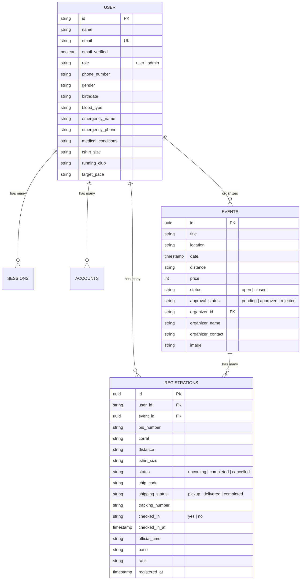

# คู่มือและเอกสารสรุประบบ IT RUNWAY (System Documentation)

**IT RUNWAY** คือ แพลตฟอร์มศูนย์รวมงานวิ่ง ระบบลงทะเบียน ออกเบอร์วิ่งดิจิทัล (Digital BIB) ระบบจับเวลา RFID การเช็คอินเข้างานด้วย QR Code และระบบจัดการแข่งขันครบวงจร สำหรับงานวิ่งในจังหวัดนครปฐมและพื้นที่ใกล้เคียง

---

## สารบัญระบบ (Table of Contents)

1. [สถาปัตยกรรมระบบและฐานข้อมูล (System Architecture & Database Schema)](#1-สถาปัตยกรรมระบบและฐานข้อมูล)
2. [ระดับผู้ใช้งานและสิทธิ์การเข้าถึง (User Roles & Permissions)](#2-ระดับผู้ใช้งานและสิทธิ์การเข้าถึง)
3. [ระบบหลักทั้งหมดของแพลตฟอร์ม (Platform Modules & Features)](#3-ระบบหลักทั้งหมดของแพลตฟอร์ม)
   - [3.1 ระบบค้นหาและสำรวจงานวิ่ง (Event Discovery & Search Command ⌘K)](#31-ระบบค้นหาและสำรวจงานวิ่ง)
   - [3.2 ระบบรายละเอียดงานวิ่งและแผนที่เส้นทาง (Event Details, Maps & Schedule)](#32-ระบบรายละเอียดงานวิ่งและแผนที่เส้นทาง)
   - [3.3 ระบบตรวจสอบความสมบูรณ์ของข้อมูลนักวิ่ง (Runner Profile Completeness & Demo Fill)](#33-ระบบตรวจสอบความสมบูรณ์ของข้อมูลนักวิ่ง)
   - [3.4 ระบบจำลองการชำระเงินและออก BIB ทันที (Payment Gateway & Digital BIB)](#34-ระบบจำลองการชำระเงินและออก-bib-ทันที)
   - [3.5 ระบบบัตร BIB ดิจิทัลและการยกเลิกการสมัคร (Digital BIB & Cancellation/Refund)](#35-ระบบบัตร-bib-ดิจิทัลและการยกเลิกการสมัคร)
   - [3.6 ระบบโอนสิทธิ์ BIB ให้เพื่อน (Self-Service BIB Transfer)](#36-ระบบโอนสิทธิ์-bib-ให้เพื่อน)
   - [3.7 ระบบขอจัดงานวิ่งสำหรับสมาชิก (Event Organizer Request & Workflow)](#37-ระบบขอจัดงานวิ่งสำหรับสมาชิก)
   - [3.8 ระบบแถบตรวจ BIB และสแกน QR Code หน้างาน (Live Check-in Gate & QR Scanner)](#38-ระบบแถบตรวจ-bib-และสแกน-qr-code-หน้างาน)
   - [3.9 ระบบจัดการข้อมูลผู้จัดงาน (Organizer Export, Size Breakdown & Tracking)](#39-ระบบจัดการข้อมูลผู้จัดงาน)
   - [3.10 ระบบผลการแข่งขัน เกียรติบัตร และภาพถ่าย (Results, e-Certificate & Photo Search)](#310-ระบบผลการแข่งขัน-เกียรติบัตร-และภาพถ่าย)
4. [รายการ API Endpoints ทั้งหมด (REST API Reference)](#4-รายการ-api-endpoints-ทั้งหมด)
5. [บัญชีผู้ใช้งานตัวอย่างสำหรับทดสอบ (Demo Credentials & Testing Guide)](#5-บัญชีผู้ใช้งานตัวอย่างสำหรับทดสอบ)
6. [ข้อมูลการติดตั้งและเผยแพร่ (Production Deployment)](#6-ข้อมูลการติดตั้งและเผยแพร่)

---

## 1. สถาปัตยกรรมระบบและฐานข้อมูล

ระบบเชื่อมต่อฐานข้อมูล **PostgreSQL** บน Cloud Database โดยมีตารางข้อมูลหลักดังนี้:

---

## 2. ระดับผู้ใช้งานและสิทธิ์การเข้าถึง

ระบบแบ่งสิทธิ์ผู้ใช้งานออกเป็น 3 บทบาท:

| บทบาท (Role) | สิทธิ์การทำงานหลักในระบบ |
| :--- | :--- |
| **1. สมาชิก / นักวิ่ง (Member / Runner)** | - ค้นหางานวิ่ง สมัครและชำระเงินจำลอง - ดูบัตร BIB ดิจิทัลพร้อมบาร์โค้ดและชิป RFID - ขอยกเลิกและคืนเงิน (Refund) ก่อนวันงาน - โอนสิทธิ์ BIB ให้เพื่อน - ดาวน์โหลด e-Certificate และค้นหาภาพถ่ายนักวิ่ง - **สามารถยื่นขอจัดงานวิ่งใหม่ได้** |
| **2. ผู้จัดงานวิ่ง (Event Organizer)** | - เมื่อสมาชิกคนใดยื่นขอจัดงานวิ่งและได้รับอนุมัติ สมาชิกท่านนั้นจะมีสิทธิ์เป็น **"ผู้จัดงาน"** ของงานนั้นๆ ทันที - สิทธิ์เข้าใช้งาน **"แถบตรวจ BIB และสแกน QR Code"** (`/organizer/checkin`) - Export รายชื่อผู้สมัครเป็น Excel/CSV - สรุปยอดตัดเย็บเสื้อ (Size Breakdown) สำหรับโรงงาน - บันทึกเลขพัสดุไปรษณีย์ (Tracking Number) |
| **3. ผู้ดูแลระบบ (Admin)** | - เข้าถึงศูนย์ควบคุมหลังบ้าน (`/admin`) - ตรวจสอบและอนุมัติ (Approve / Reject) คำขอจัดงานวิ่งที่สมาชิกยื่นเข้ามา - จัดการสมาชิกในระบบ - มีสิทธิ์เข้าตรวจ BIB ได้ทุกงานในระบบ |

---

## 3. ระบบหลักทั้งหมดของแพลตฟอร์ม

### 3.1 ระบบค้นหาและสำรวจงานวิ่ง
- **หน้าหลัก ([`/events`](https://it-runway.vercel.app/events))**:
  - แสดงการ์ดงานวิ่งในจังหวัดนครปฐม (พระปฐมเจดีย์, ม.เกษตรฯ กำแพงแสน, พระราชวังสนามจันทร์, ฯลฯ)
  - ตัวกรองระยะทาง (5K, 10K, 21K, 42K, Trail)
  - ตัวกรองสถานะ (เปิดรับสมัคร, ปิดรับสมัคร) และช่วงราคา
  - โหมดแสดงผลแบบปฏิทินงานวิ่ง ([`/calendar`](https://it-runway.vercel.app/calendar))
- **กล่องค้นหาอัจฉริยะ (Search Command Dialog `⌘K` / `Ctrl+K`)**:
  - ค้นหาแบบเรียลไทม์พร้อมระบบ Autocomplete
  - ปุ่มสแกน QR Code จากกล่องค้นหาได้โดยตรง

---

### 3.2 ระบบรายละเอียดงานวิ่งและแผนที่เส้นทาง ([`/events/[id]`](https://it-runway.vercel.app/events))
- แสดงภาพแบนเนอร์ความคมชัดสูง วันที่ เวลาปล่อยตัว สถานที่จัดงาน
- แถบนำทาง 6 แท็บ:
  1. **ภาพรวมและไฮไลท์งาน (Overview)**
  2. **แบบเสื้อและตารางไซส์ (Shirt Design & Size Chart)**
  3. **แผนที่เส้นทางและจุดให้น้ำ (Route Maps & Elevation Profile)**
  4. **กำหนดการวันงาน (Race Schedule & Timeline)**
  5. **ของรางวัลและกติกา (Awards & Regulations)**
  6. **ข้อมูลผู้จัดงานและติดต่อ (Organizer Contact)**

---

### 3.3 ระบบตรวจสอบความสมบูรณ์ของข้อมูลนักวิ่ง
- **ข้อกำหนดความปลอดภัย (Mandatory Runner Info)**:
  - นักวิ่งต้องกรอกข้อมูลให้ครบ 7 ฟิลด์ก่อนทำการสมัคร:
    1. ชื่อ-นามสกุล
    2. เบอร์โทรศัพท์ติดต่อ
    3. เพศ
    4. วัน/เดือน/ปีเกิด (สำหรับแบ่งรุ่นอายุ)
    5. หมู่โลหิต (สำหรับการแพทย์ฉุกเฉิน)
    6. ชื่อผู้ติดต่อกรณีฉุกเฉิน
    7. เบอร์โทรศัพท์ติดต่อฉุกเฉิน
- **การบล็อกเมื่อข้อมูลไม่ครบ**:
  - ในหน้าต่างชำระเงิน ปุ่มชำระเงินจะถูกปิดใช้งาน (Disabled) พร้อมแจ้งเตือนรายการที่ยังขาด
  - ระบบ Backend API (`/api/events/register`) ตรวจสอบซ้ำและปฏิเสธหากข้อมูลไม่ครบ
- **ปุ่ม Demo ข้อมูลสำหรับทดสอบ**:
  - หน้าต่างสมัครมีปุ่ม **"⚡ กรอก Demo ทั้งหมด & ปลดล็อก"** 1-Click
  - หน้าข้อมูลบัญชีนักวิ่ง ([`/account`](https://it-runway.vercel.app/account)) มีปุ่ม `⚡ Demo` ประจำอยู่ข้างๆ ทุกช่องข้อมูล พร้อมปุ่มเลือกชุดโปรไฟล์สำเร็จรูป 3 รูปแบบ

---

### 3.4 ระบบจำลองการชำระเงินและออก BIB ทันที
- รองรับช่องทางการชำระเงินจำลอง 4 รูปแบบ:
  1. **พร้อมเพย์ (PromptPay QR Code)**: แสดง QR Code ยอดเงินตรงตามระยะทาง พร้อมระบบสแกนจำลอง
  2. **บัตรเครดิต / เดบิต (Credit/Debit Card)**: ฟอร์มกรอกบัตรพร้อมปุ่มสุ่มเลขบัตรทดสอบ
  3. **โมบายแบงก์กิ้ง (Mobile Banking)**: เลือกธนาคาร K PLUS, SCB EASY, Krungthai NEXT
  4. **ทรูมันนี่ (TrueMoney Wallet)**
- เมื่อกดยืนยันชำระเงิน ระบบจะจำลองขั้นตอน Payment Gateway (กำลังเชื่อมต่อธนาคาร -> ตรวจสอบยอด -> อนุมัติธุรกรรม) และออกหมายเลข BIB พร้อมรหัสชิปจับเวลา RFID ทันที

---

### 3.5 ระบบบัตร BIB ดิจิทัลและการยกเลิกการสมัคร ([`/account/bibs`](https://it-runway.vercel.app/account/bibs))
- **บัตร BIB ดิจิทัล (Interactive Digital BIB Card)**:
  - แสดงหมายเลข BIB ขนาดใหญ่, ชื่อนักวิ่ง, ระยะทาง, ไซส์เสื้อ, กลุ่มปล่อยตัว (Corral)
  - QR Code & Barcode สำหรับสแกนเข้างาน
  - รหัสชิป RFID ประจำตัวนักวิ่ง
  - สถานะการรับอุปกรณ์ (รับหน้างาน Expo หรือ จัดส่งไปรษณีย์พร้อมเลขพัสดุ)
  - ปุ่ม **"ดาวน์โหลดรูป (PNG)"** และ **"พิมพ์บัตร BIB (Print)"**
- **ระบบขอยกเลิกและคืนเงิน (Cancellation & Refund)**:
  - นักวิ่งสามารถกดยกเลิกงานวิ่งได้ด้วยตนเอง
  - เลือกเหตุผลการยกเลิก และเลือกช่องทางรับเงินคืน (PromptPay / บัญชีธนาคาร)
  - ระบบจะคำนวณยอดเงินคืนและยกเลิกรายการ BIB ในฐานข้อมูลทันที

---

### 3.6 ระบบโอนสิทธิ์ BIB ให้เพื่อน
- ให้นักวิ่งที่ไม่สะดวกมาร่วมงานสามารถส่งต่อสิทธิ์ให้เพื่อนได้โดยไม่มีค่าธรรมเนียม
- กรอกข้อมูลผู้รับสิทธิ์คนใหม่ (ชื่อ, เบอร์โทร, เพศ, ข้อมูลติดต่อฉุกเฉิน)
- มีปุ่ม **"⚡ Demo กานดา (หญิง)"** และ **"⚡ Demo สมชาย (ชาย)"** สำหรับทดสอบ
- ระบบจะอัปเดตข้อมูลผู้เข้าแข่งขันและออกรหัสชิป RFID ใหม่ให้อัตโนมัติ

---

### 3.7 ระบบขอจัดงานวิ่งสำหรับสมาชิก ([`/organize`](https://it-runway.vercel.app/organize))
- สมาชิกทุกคนสามารถยื่นขอจัดงานวิ่งในจังหวัดนครปฐมได้
- แบบฟอร์มกรอกข้อมูล 4 ส่วน: ข้อมูลงาน, ระยะทางและราคา, กำหนดการและสถานที่, ข้อมูลผู้จัดงาน
- มีปุ่ม **"⚡ กรอกข้อมูล Demo 1-Click"** (เช่น งาน Nakhon Pathom Marathon, เจดีย์มินิมาราธอน)
- เมื่อส่งแบบฟอร์ม งานจะถูกส่งเข้าสู่ระบบรอการตรวจสอบ (Pending) ไปยัง Admin Dashboard

---

### 3.8 ระบบแถบตรวจ BIB และสแกน QR Code หน้างาน ([`/organizer/checkin`](https://it-runway.vercel.app/organizer/checkin))
- แถบตรวจสำหรับผู้จัดงานและแอดมิน:
  - ค้นหาด้วยหมายเลข BIB, ชื่อนักวิ่ง, เบอร์โทร หรือรหัสชิป RFID
  - **กล้องสแกน QR Code สด (Live Camera Viewfinder)**:
    - เส้นเลเซอร์สแกนและกรอบเล็งเป้า
    - เสียงปี๊บตอบรับเมื่อสแกนสำเร็จ (Audio Chime Feedback ผ่าน Web Audio API)
    - ระบบสั่น (Vibration API บนมือถือ)
    - รองรับการอัปโหลดไฟล์ภาพ QR Code
    - ปุ่มจำลองสแกน BIB ตัวอย่างสำหรับทดสอบ
  - ตารางรายชื่อนักวิ่งทั้งหมดพร้อมปุ่ม **"เช็คอิน"** และ **"ยกเลิกการเช็คอิน"**
  - ตัวนับสถิติเรียลไทม์ (% การเช็คอินเข้างาน)

---

### 3.9 ระบบจัดการข้อมูลผู้จัดงาน
- **Export รายชื่อผู้สมัคร (CSV/Excel)**:
  - ดาวน์โหลดไฟล์ `.csv` แบบ UTF-8 BOM รองรับภาษาไทยใน Microsoft Excel 100%
  - ประกอบด้วยข้อมูลนักวิ่งครบ 17 คอลัมน์
- **สรุปยอดสั่งผลิตเสื้อ (T-Shirt Size Breakdown)**:
  - แดชบอร์ดสรุปยอดจำนวนเสื้อแยกตามไซส์ (XS, S, M, L, XL, 2XL, 3XL) และจำแนกตามระยะทาง
  - ปุ่มดาวน์โหลดใบสั่งผลิตเสื้อส่งโรงงานตัดเย็บ (CSV)
- **จัดการเลขพัสดุจัดส่ง (Shipping & Tracking Manager)**:
  - หน้าต่างจัดการและบันทึกเลขพัสดุ (EMS / Flash / Kerry)
  - ปุ่ม **"⚡ สุ่มเลขพัสดุ Demo อัตโนมัติ"** สำหรับทดสอบ ซิงค์ไปยังหน้า Digital BIB ของนักวิ่งทันที

---

### 3.10 ระบบผลการแข่งขัน เกียรติบัตร และภาพถ่าย ([`/results`](https://it-runway.vercel.app/results))
- **ตารางผลการแข่งขันสด (Live Leaderboard)**:
  - รายงานเวลา Chip Time, Gun Time, Pace, อันดับ Overall, อันดับเพศ และอันดับรุ่นอายุ
  - ตัวกรองระยะทาง เพศ และรุ่นอายุ
- **เกียรติบัตรอิเล็กทรอนิกส์ (e-Certificate)**:
  - ออกเกียรติบัตรสีทอง Nakhon Pathom Finisher สวยงาม
  - ปุ่มดาวน์โหลดภาพความละเอียดสูง 1600x1130 px (PNG) และปุ่มสั่งพิมพ์
- **ค้นหาภาพถ่ายนักวิ่งตาม BIB (Runner Photo Search)**:
  - พิมพ์เลข BIB เพื่อค้นหาภาพถ่ายตนเองในสนาม
  - กรองตามจุดเช็คพอยต์ (จุดปล่อยตัว, กม. 5 ถนนต้นสน, กม. 15 พระราชวังสนามจันทร์, เส้นชัย พระปฐมเจดีย์, ซุ้มรับเหรียญรางวัล)
  - ปุ่ม Lightbox ขยายดูภาพต้นฉบับและปุ่มดาวน์โหลดภาพความคมชัดสูง

---

## 4. รายการ API Endpoints ทั้งหมด

| Method | Endpoint | คำอธิบาย | สิทธิ์การเข้าถึง |
| :--- | :--- | :--- | :--- |
| `GET` | `/api/events` | ดึงรายการงานวิ่งทั้งหมด | ทุกคน (Public) |
| `POST` | `/api/events/register` | สมัครงานวิ่งและออก BIB (ตรวจ Profile 7 ฟิลด์) | สมาชิกที่เข้าสู่ระบบ |
| `POST` | `/api/events/cancel` | ขอยกเลิกงานวิ่งและจำลองการคืนเงิน | เจ้าของ BIB / Admin |
| `POST` | `/api/events/transfer` | โอนสิทธิ์ BIB ให้แก่นักวิ่งท่านอื่น | เจ้าของ BIB / Admin |
| `POST` | `/api/events/request` | ยื่นคำขอจัดงานวิ่งใหม่ | สมาชิกที่เข้าสู่ระบบ |
| `GET` | `/api/user/profile` | ดึงข้อมูลโปรไฟล์นักวิ่ง | สมาชิกที่เข้าสู่ระบบ |
| `PUT` | `/api/user/profile` | อัปเดตข้อมูลส่วนตัวนักวิ่ง 7 ฟิลด์ | สมาชิกที่เข้าสู่ระบบ |
| `GET` | `/api/user/bibs` | ดึงรายการ BIB ทั้งหมดของนักวิ่ง | สมาชิกที่เข้าสู่ระบบ |
| `GET` | `/api/organizer/participants` | ดึงรายชื่อนักวิ่งและสถิติเช็คอินของงาน | ผู้จัดงาน / Admin |
| `POST` | `/api/organizer/checkin` | เช็คอิน / ยกเลิกการเช็คอิน BIB หรือ ชิป RFID | ผู้จัดงาน / Admin |
| `POST` | `/api/organizer/tracking` | อัปเดตหมายเลขพัสดุไปรษณีย์ | ผู้จัดงาน / Admin |
| `GET` | `/api/organizer/status` | ตรวจสอบว่าผู้ใช้ปัจจุบันมีงานที่จัดอยู่หรือไม่ | สมาชิกที่เข้าสู่ระบบ |
| `GET` | `/api/results` | ดึงผลการแข่งขันและตารางอันดับ Finisher | ทุกคน (Public) |
| `GET` | `/api/admin/requests` | ดึงรายการคำขอจัดงานวิ่งที่รออนุมัติ | เฉพาะ Admin |
| `POST` | `/api/admin/requests/action` | อนุมัติ (Approve) หรือ ปฏิเสธ (Reject) งานวิ่ง | เฉพาะ Admin |
| `GET` | `/api/admin/users` | จัดการรายชื่อสมาชิกและสิทธิ์ในระบบ | เฉพาะ Admin |

---

## 5. บัญชีผู้ใช้งานตัวอย่างสำหรับทดสอบ

ระบบมีปุ่ม **"1-Click Auto Fill Demo"** ในหน้าเข้าสู่ระบบ ([`/auth/sign-in`](https://it-runway.vercel.app/auth/sign-in)) หรือกรอกข้อมูลดังนี้:

### บัญชีสมาชิกทั่วไป (Member / Runner)
- **Username / Email**: `user-runway` หรือ `user-runway@it-runway.com`
- **Password**: `user-runway`
- **สิทธิ์**: สมัครงานวิ่ง, ชำระเงินจำลอง, ดู BIB, โอนสิทธิ์, ยกเลิกงาน, ขอจัดงานวิ่ง

### บัญชีผู้ดูแลระบบ (Platform Admin)
- **Username / Email**: `admin-runway` หรือ `admin-runway@it-runway.com`
- **Password**: `admin-runway`
- **สิทธิ์**: เข้าถึงแผงควบคุมหลังบ้าน (`/admin`), อนุมัติ/ปฏิเสธคำขอจัดงานวิ่ง, ตรวจ BIB ทุกงาน

---

## 6. ข้อมูลการติดตั้งและเผยแพร่

- **Production URL**: [https://it-runway.vercel.app](https://it-runway.vercel.app)
- **สถานะระบบ**: ทำงานปกติ 100% (Production Ready)
- **เทคโนโลยีแกนหลัก**: TypeScript, Server-Side Rendering, PostgreSQL Cloud Database, Web Audio API, HTML5 Canvas Rendering
